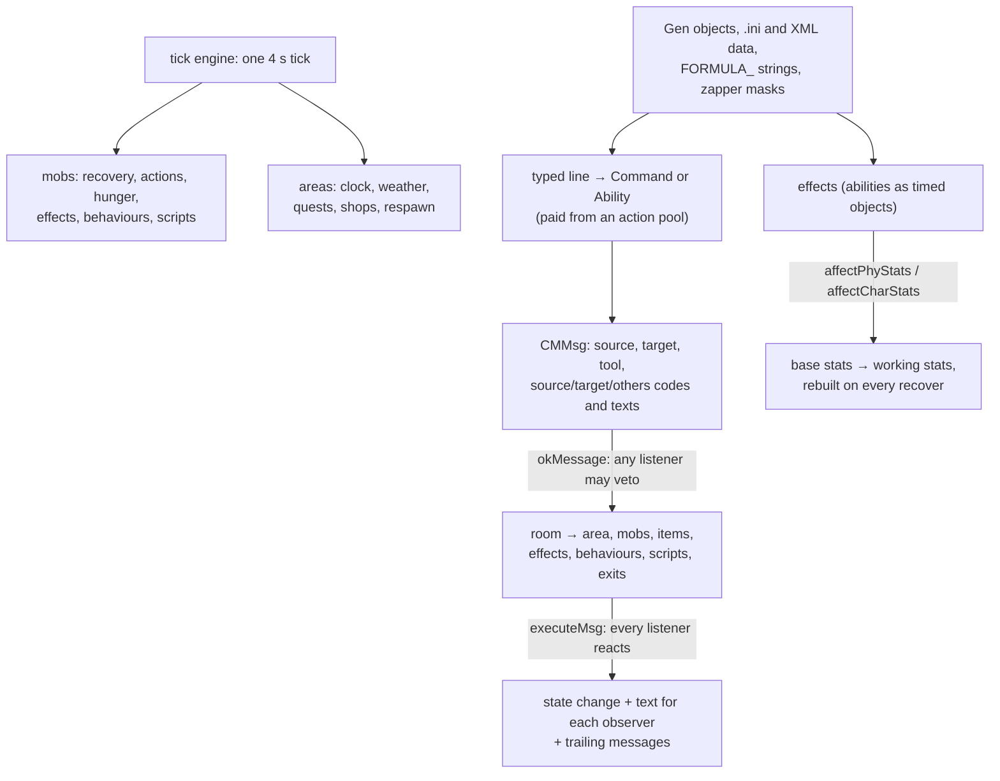

# CoffeeMud: overview

> **Note.** This analysis was written before CoffeeSUD existed, when the plan was a separate single-player game in Python that would borrow from CoffeeMud. The project instead forked CoffeeMud itself, in Java. The chapters still describe the engine CoffeeSUD is built on, but their "takeaways for a Python SUD" are from that earlier plan. For CoffeeSUD as it is now, see the [top-level README](../README.md) and [`PLAN.md`](../PLAN.md).

This folder is the analysis of **CoffeeMud** for the SUD design project. It covers how CoffeeMud's engine is built, which of its generic systems a single-player Python text game could borrow, and what content it ships. Start here, then use the chapter index. The code is in the parent folder (`ref/mudlibraries/CoffeeMUD/`). Paths in the chapters are relative to that folder.

**Scope.** This analysis is about the **engine and its generic systems**: the object model and message bus, ticks, stats and effects, the ability framework, combat, movement, rooms and areas, items, mobs, commands, behaviours, scripting, quests, factions, shops, law and crafting. Large content families were read only far enough to explain how they work. For example, the spell chapters cover the `Spell` base class and the first two-thirds of the spell files, and the remaining spells, most thief skills, and the race and class catalogues were left out. See [Not analysed](#not-analysed).

## What CoffeeMud is

CoffeeMud is a large, long-lived **MUD server**, a multiplayer text game engine written entirely in Java. It is inspired by AD&D and ROM-style MUDs and has been developed since 2000. It ships a complete fantasy game: dozens of races and character classes; thousands of spells, prayers, druid chants, songs, skills and crafts; clans, law, economy, quests and achievements; and optional technology and space systems. Almost everything can be edited in the running game through "Gen" objects, which store their fields as data. Help files, recipes, quests, random areas, socials and factions live in text and XML files under `resources/`.

| | |
|---|---|
| Version | `HOST_VERSION = "5.11.0.4"` (`com/planet_ink/coffee_mud/application/MUD.java:86`); `CHANGES` opens with build 5.11.1 in progress |
| Licence | Apache License 2.0 (`LICENSE`) |
| Java | 5,260 files, about 1.47 million lines. 5,159 files are under `com/planet_ink/coffee_mud/`, and the other 101 are the embedded web server, a flat-file SQL driver and a browser telnet client |
| Largest packages | `Abilities` 2,572 files; `Items` 493; `Libraries` 348; `Commands` 311; `core` 270; `Races` 252; `WebMacros` 237; `MOBS` 158; `Locales` 131; `Behaviors` 102; `CharClasses` 57 |
| Data | `resources/`: 344 files, 8.1 MB (help, recipes, quests, socials, factions, laws, random areas, lists); `guides/`: 13 MB of HTML manuals |

## How to read this analysis

- **Organisation.** All Java was split into 173 buckets by package and theme, most of them between 6,000 and 10,000 lines and a few up to about 16,000. The data files were split into 14 content buckets. Five buckets (`b169` to `b173`) were added late to cover the generic base classes for classes and races, commands, rooms, items and mobs in depth. Each analysed bucket became one chapter (150 in all, plus this README), filed under one of fourteen folders: `engine/`, `rules/`, `actors/`, `world/`, `items/`, `commands/`, `behaviors/`, `conditions/`, `skills/`, `magic/`, `crafting/`, `society/`, `admin/` and `content/`. `_coverage/` lists exactly which files each bucket covers, and `_coverage/_index.tsv` maps buckets to chapters.
- **Citations.** `Libraries/MUDFight.java:1007` is a path relative to `com/planet_ink/coffee_mud/` or to the CoffeeMud folder, with a line number. Chapters name classes by their Java name (`StdAbility`) and abilities by their `ID()` (`Spell_Fireball`).
- **How it was written.** AI agents (Claude Haiku) read the code statically. They were told to cite every claim, never invent numbers, and keep what the code does apart from what comments and the guides claim. Nothing was compiled or run. Bugs are "found by reading". A sample of claims was checked against the source; see [Verification](#verification).
- **Chapter format.** Summary, Key files and types, How it works, **Content worth mining**, Notable design ideas, Problems and cruft, Takeaways for a Python SUD, and Coverage. To skim the whole engine, read the Summary and Takeaways of each chapter in the [Engine](#engine) and [Rules](#rules-abilities-combat-and-eligibility) sections.
- **Personal data and secrets.** `resources/ipblock.ini` and `resources/text/credits.txt` were excluded. The chapters do not reproduce names, handles, email addresses, IP addresses or credentials from file headers, configuration or examples.

## The architecture in one page

Most of CoffeeMud rests on eight mechanisms. Nearly every chapter is a variation on them.

1. **Prototypes by ID, services by name.** `CMClass` loads every race, class, mob, item, ability, behaviour and command at boot and hands out fresh copies by `ID()` string. `CMLib` is a service locator for 55 libraries (`CMLib.combat()`, `CMLib.dice()`, `CMLib.coffeeShops()` and so on), each reached by its interface. Content refers to code only by these IDs. ([class and library registries](engine/b001-class-registry-library-registry-and-resources.md))
2. **Every action is a message with a veto phase.** An action becomes a `CMMsg` with a source, target and tool, and three codes and texts: one for the actor, one for the target and one for everyone else. Each code combines perception bits (hands, eyes, mouth, sound, movement) with an action type. The caller asks the room's `okMessage`, which polls the area, the mobs, items, effects, behaviours, scripts and exits; any one can refuse. Only then does `send` run `executeMsg` on all of them and the trailing follow-up messages (`Commands/Drop.java:66-68`, `Locales/StdRoom.java:745-898`, `:1734-1739`). Because the perception bits travel with the message, one message gives the right text to each observer. ([CMMsg](engine/b003-core-object-model-environmental-interfaces-and-the-message-c.md), [rooms](world/b171-rooms-grids-and-exits-models-and-base-classes.md))
3. **One clock.** Mobs, items, rooms, areas, effects, behaviours and scripts register as `Tickable` and are called every tick, 4 seconds by default (`TIME_TICK = 4000`, `core/CMProps.java:681`). Durations are counted in ticks. A mud hour is 10 real minutes by default (`MILLIS_PER_MUDHOUR = 600000`, `:682`). Each area has its own calendar and weather on that clock. ([tick engine](engine/b004-server-boot-tick-engine-and-threads.md), [time and climate](world/b024-time-calendar-and-climate.md))
4. **Stats are rebuilt, never edited.** Every object has a base and a working copy of its physical stats, and characters add character stats (attributes, saves, race, class) and vitals. Each recovery copies the base and lets the race, class, gear and every active effect modify it through `affectPhyStats`, `affectCharStats` and `affectCharState`. Removing an effect undoes it automatically. ([stats](actors/b009-physical-character-and-state-stats.md), [mob model](actors/b173-mobs-the-mob-model-stdmob-and-generic-npc-classes.md))
5. **Everything that changes something is an Ability.** Spells, prayers, chants, songs, skills, crafts, diseases, poisons, traps, languages and attached "properties" all extend `StdAbility`. Casting runs a fixed sequence of checks (alive, cooldown, cost in mana, movement or hit points, a proficiency roll), and a lasting result is a **copy** of the ability attached to the target with its own tick countdown. Proficiency rises by use. ([ability base classes](rules/b058-abilities-base-classes.md), [ability mapping and expertise](rules/b028-ability-mapping-qualification-and-expertise.md))
6. **Numbers are data.** Combat hit, damage, crit and XP rules are `FORMULA_*` strings in `coffeemud.ini`, evaluated by a small expression language. Percentile tests are clamped to 5..95 (`Libraries/Dice.java:69-75`). Weapons and armour derive their numbers from one "power level". ([combat and dice](rules/b025-combat-dice-and-item-balance.md), [configuration](content/c01-configuration-files-coffeemud-ini-lists-laws-and-web-setting.md))
7. **Gen objects make the world editable.** `GenMob`, `GenItem`, `GenRace`, `GenCharClass`, `GenAbility` and others keep every field as data (XML in the database) and expose it through named stat codes. The `Std*` classes are the hard-coded defaults. ([CoffeeMaker serialisation](engine/b016-object-builder-and-xml-serialisation-coffeemaker.md), [classes and races](actors/b169-character-classes-and-races-models-and-base-classes.md))
8. **Small languages everywhere.** Zapper masks (`-LEVEL +>10 -RACE +Elf`) say who qualifies for anything. MOBPROG scripts attach event-driven logic to mobs, rooms and items. Quest scripts set up the world and undo their changes when they end. MUDPercolator XML generates whole areas. ([zapper masks](rules/b018-zapper-masks-the-eligibility-language.md), [MOBPROG](engine/b037-scripting-engine-mobprog-scriptable.md), [quests](society/b031-quests.md), [random areas](world/b020-random-area-generation-mudpercolator-and-layouts.md))

On top of these sit the behaviours (NPC and area AI as attachable objects), factions, shops and money, law, crafting and the commands. The chapters below cover each.

## What is most worth borrowing

**The core loop**
- **The two-phase message bus.** One action, one message, any listener may veto it, then every listener reacts. Terrain, gear, spells, NPC scripts and laws all hook the same flow, so new rules need no changes to the verbs. In Python this is one `Event` dataclass and two passes over a location's listeners. ([CMMsg](engine/b003-core-object-model-environmental-interfaces-and-the-message-c.md), [core verbs](commands/b170-commands-the-base-class-and-the-core-verbs.md))
- **Per-observer text from one message.** Message strings carry tokens (`<S-NAME>`, `<T-NAME>`) and the perception bits decide who sees, hears or misses the action. A blind or sleeping player gets the right text without special cases. ([CMMsg](engine/b003-core-object-model-environmental-interfaces-and-the-message-c.md), [senses and flags](engine/b015-senses-flags-and-miscellaneous-utilities.md))
- **Actions paid from a pool.** Each verb declares an action cost (0.20 out of combat and 1.0 in combat for most core verbs, `coffeemud.ini:545-546`). A mob's pool refills by its speed every tick, so typed commands queue and pace themselves without per-verb timers. A turn-based SUD can use the same numbers as time costs. ([core verbs](commands/b170-commands-the-base-class-and-the-core-verbs.md), [sessions](engine/b011-sessions-the-player-connection-and-input-loop.md))
- **Base plus effects, recomputed.** Stats are never written directly. Effects are objects with a countdown that add to a fresh copy of the base. ([stats](actors/b009-physical-character-and-state-stats.md))

**Abilities and rules**
- **Template and effect.** The learned ability is a template, and each cast makes a copy that carries the timer and target, so a character's skill list holds no per-target state. ([ability base classes](rules/b058-abilities-base-classes.md))
- **Proficiency by use.** The check starts from proficiency, adds adjustments, clamps to 5..95 and rolls percentile. Each attempt can raise proficiency by 1. Practice with a teacher gains `round(25 × (teacher WIS + student INT) / 36)` per session, capped at 75% of the maximum and at the teacher's own proficiency. ([ability base classes](rules/b058-abilities-base-classes.md))
- **Expertise as named modifiers.** Purchasable upgrade stages attach to groups of skills and change level, cost, time, range or power through twelve modifier types that skill code reads. ([ability mapping and expertise](rules/b028-ability-mapping-qualification-and-expertise.md))
- **Properties: one rule per object, configured by a string.** `Prop_HaveAdjuster` with `str+2 dex-2 MASK=-Race +Dwarf` is a complete rule. Dozens of such classes cover stat changes, gates, immunities, shop hours, movement limits and traps. ([properties 1](conditions/b075-abilities-properties-part1.md), [2](conditions/b076-abilities-properties-part2.md), [3](conditions/b077-abilities-properties-part3.md), [4](conditions/b078-abilities-properties-part4.md))
- **Zapper masks as eligibility.** One compact string answers "who may use, enter, learn or receive this". Keep the idea and use a simpler predicate syntax. ([zapper masks](rules/b018-zapper-masks-the-eligibility-language.md))
- **Formulas in configuration.** Hit, damage, crit and XP are editable expressions, so balancing needs no code change. ([combat and dice](rules/b025-combat-dice-and-item-balance.md))

**A world that runs itself**
- **Behaviours as attachable AI.** NPC and area routines (wander, guard, beg, scavenge, fight with abilities, run a market, raise weather) are small classes configured by parameter strings and attached to any mob or area. ([behaviours 1](behaviors/b102-behaviors-part1.md), [2](behaviors/b103-behaviors-part2.md), [3](behaviors/b104-behaviors-part3.md), [4](behaviors/b105-behaviors-part4.md), [5](behaviors/b106-behaviors-part5.md))
- **Law as data and an NPC pipeline.** Crimes are five-field rows in `laws.ini`. A detected act becomes a warrant that officers walk through a 15-state machine (seek, arrest, subdue, transport, judge, then parole, jail, banish or execute, and release). ([legal behaviour](behaviors/b102-behaviors-part1.md), [law, property and materials](society/b036-law-property-titles-materials-and-follower-orders.md))
- **Quests with an undo journal.** A quest script selects or creates mobs, items and rooms, attaches behaviours and effects, and reverses all of it when the quest ends. The same engine runs scheduled holidays and a mystery generator that picks one culprit, motive, place, time and tool from candidate pools. ([quests](society/b031-quests.md), [random quests](content/c06-random-quest-templates-random-and-holiday-quests.md), [quest templates](content/c07-quest-templates-for-builders.md))
- **Factions as scalars with bands and rules.** A faction is one integer axis with named bands. Values change through rule tables keyed to kills, speech, socials, ability use and time. The same band lookup gates abilities and NPC reactions. ([factions](society/b032-factions.md))
- **Per-area time and weather.** Each area has a configurable calendar and a weighted weather chain over 14 states with a one-step forecast. Moon phase and tides are derived from the date. ([time and climate](world/b024-time-calendar-and-climate.md))
- **Area states.** An area is ACTIVE, PASSIVE, FROZEN or STOPPED, and only active areas tick fully, so empty places cost nothing. Instances are copied when a group enters. ([areas](world/b101-areas.md))
- **Shops with personality and a budget.** Prices come from base value, the buyer's charisma, the shopkeeper's wisdom, stock on hand and local tax, with prejudice by customer group and a cash budget per period. ([shops and money](society/b030-shops-money-and-auctions.md), [shopkeepers and service mobs](actors/b148-mobs-part4.md))
- **Generated places and errands.** MUDPercolator first builds an abstract room graph (maze, tree, grid city and others), then fills each node from templates that can test the node's shape. Random quests pick real NPCs, rooms and items with world queries. ([random areas](world/b020-random-area-generation-mudpercolator-and-layouts.md), [random quests](content/c06-random-quest-templates-random-and-holiday-quests.md))

**Making things**
- **Recipes as tab-separated rows.** Every trade skill reads recipe rows whose columns are declared by the skill class. It takes materials from the floor, runs a timed action and produces an item, or a ruined one on failure. ([crafting engine](crafting/b044-abilities-common-part3.md), [recipes 1](content/c04-crafting-recipes-and-skill-data-part-1.md), [recipes 2](content/c05-crafting-recipes-and-skill-data-part-2.md))
- **Materials with physics.** 210 raw resources in 16 material families, each with value, gather weight, hardness, density and flags, feed gathering, crafting difficulty, item wear and balance. ([item interfaces](items/b136-items-interfaces.md), [materials](society/b036-law-property-titles-materials-and-follower-orders.md))
- **Room depletion.** Gathering reduces a room's yield, and the yield recovers after 30 real minutes. On a game clock this becomes regrowth. ([crafting engine](crafting/b044-abilities-common-part3.md))

## Content worth mining

| Content | Where | Size |
|---|---|---|
| Socials (emotes with actor, target and room text) | `resources/socials.txt` | 843 variants over 338 verbs ([socials](content/c03-socials-mudchat-lines-factions-and-screen-texts.md)) |
| NPC small talk (pattern and weighted reply) | `resources/chat.dat` | MUDChat rules for dogs, cats, healers and others ([socials and chat](content/c03-socials-mudchat-lines-factions-and-screen-texts.md)) |
| Crafting recipes | `resources/skills/*.txt` | Smithing, tailoring, carpentry, cooking, alchemy, jewellery, pottery, ships and more ([recipes 1](content/c04-crafting-recipes-and-skill-data-part-1.md), [recipes 2](content/c05-crafting-recipes-and-skill-data-part-2.md)) |
| Achievements and calendar awards | `resources/achievements.ini`, `awards.txt` | 1,235 achievements over 47 event types; 1,027 award rules ([achievements](content/c02-achievements-awards-and-clan-governments.md)) |
| Quest templates | `resources/quests/` | 74 builder templates in ten goal types; random-quest grammars; four holidays ([templates](content/c07-quest-templates-for-builders.md), [random quests](content/c06-random-quest-templates-random-and-holiday-quests.md)) |
| Help text | `resources/help/*.ini` | 5,614 entries, including 419 spells, 364 prayers, 316 chants, 69 diseases and 79 traps ([player help](content/c08-player-help-files.md)) |
| Phrase and chart tables | `resources/lists.ini` | XP ladder, damage words, weather, personality traits, wand words, condition text ([configuration](content/c01-configuration-files-coffeemud-ini-lists-laws-and-web-setting.md)) |
| Laws and crimes | `resources/laws.ini` | Crimes, punishments and taxes as data ([law](society/b036-law-property-titles-materials-and-follower-orders.md)) |
| Materials | `Items/interfaces/RawMaterial.java` and `coffeemud.ini` | 210 resources in 16 families ([item interfaces](items/b136-items-interfaces.md)) |
| Diseases | `Abilities/Diseases/` | Escalation chains such as flu to fever and infection to gangrene ([diseases 1](conditions/b049-abilities-diseases-part1.md), [2](conditions/b050-abilities-diseases-part2.md)) |
| Traps and bombs | `resources/skills/traps.txt`, `bombs.txt` | 41 settable traps and 13 bomb types ([traps](conditions/b100-abilities-traps.md)) |
| Languages | `Abilities/Languages/` | Garbling by proficiency; a 10,190-entry Draconic lexicon ([languages 1](skills/b062-abilities-languages-part1.md), [2](skills/b063-abilities-languages-part2.md)) |
| Creatures | `MOBS/` | Dragons by colour, animals and monsters as stat blocks ([mobs 1](actors/b145-mobs-part1.md), [2](actors/b146-mobs-part2.md)) |
| Deities | `resources/examples/deities.cmare` | Nine sample deities with blessings, powers and rituals ([special mobs](actors/b147-mobs-part3.md)) |

The spell, prayer, chant and song chapters each end with a catalogue table of their members, and the item chapters list their stock items. The guides (`guides/*.html`) are summarised in three chapters ([players and builders](content/c11-guides-for-players-and-builders.md), [ArchonGuide and Scriptable](content/c12-guides-for-administrators-and-scripters-archonguide-and-scri.md), [programmers](content/c13-guides-for-programmers-and-operators.md)).

## From MUD to single-player

CoffeeMud is already a text game, so most of it carries over. What changes is the number of people:

- **Other players become NPCs or disappear.** Groups, follower orders, clans, player killing, auctions between players, channels, journals, accounts and polls assume other people. Keep their NPC-facing halves: hirelings and followers, a clan as a faction with ranks, an NPC auctioneer, journals as an in-world notice board. ([clans](society/b027-clans-and-clan-governments.md), [journals and channels](society/b033-journals-channels-and-socials.md), [player registry](actors/b026-player-registry-polls-and-listings.md))
- **The tick can become a turn.** With one player there is no need for thread pools, tick groups or watchdogs. The 4-second tick becomes one step of a scheduler, and action costs become turn costs. Durations in ticks convert directly. ([tick engine](engine/b004-server-boot-tick-engine-and-threads.md))
- **Area states save the work.** Only the player's area needs full ticks; others can be passive or catch up on entry, which CoffeeMud already models with its area states. ([areas](world/b101-areas.md))
- **Builders become authors.** In-game editors, web pages and the database exist so many builders can edit a live world. A single-player game can load the same kinds of data from files and skip the editors. ([generic editor](admin/b017-generic-object-editor-cmgeneditor.md), [database](engine/b138-core-database-part1.md))
- **Protocols reduce to a terminal.** Telnet negotiation, MXP, MSP and GMCP are for MUD clients. Keep the colour codes and the output filters. ([protocols](engine/b012-protocols-telnet-options-mxp-msp-gmcp-encoders-and-mail.md), [text output](engine/b013-text-output-colour-codes-filters-translation-and-help.md))

## Sensitive content

CoffeeMud is mostly a conventional fantasy game. A few systems touch adult or harsh themes, and the chapters describe them plainly with explicit text paraphrased: some crude socials and a small number of crude MUDChat lines ([socials](content/c03-socials-mudchat-lines-factions-and-screen-texts.md)); pregnancy, birth and ageing, in which a baby grows into a character ([misc effects 3](skills/b066-abilities-misc-part3.md), [misc effects 1](skills/b064-abilities-misc-part1.md)); slavery and geas follower orders and a slave trade ([law and follower orders](society/b036-law-property-titles-materials-and-follower-orders.md), [skills 2](skills/b080-abilities-skills-part2.md)); drugs, alcohol and poisons ([poisons](skills/b040-abilities-small-families-part2.md)); and body modification and macabre crafts ([common skills 7](crafting/b048-abilities-common-part7.md)).

The agents were told to state only the location of any code that places minors in a sexual context. None was reported, and a final scan for child-related terms near adult terms found only benign matches (child rooms in grids, nanny and baby mobs, a child-labour skill, a sex-change spell and similar). One gap is worth carrying forward: the druid mating chants check race and reproduction but not age, while one of them (`Chant_FishyFecundity`) does test the age category ([druid chants 3](magic/b053-abilities-druid-part3.md), Problem 18). A Python port should apply an explicit adult-age test to every pairing rule, or leave pairing out.

## What not to copy

- **Bugs in the core loops.** The chapters found, by reading, a room visit set that treats every room of the same class as already visited (`Libraries/MUDTracker.java:846` with `Locales/StdRoom.java:1402-1404`), an item list that removes a live item when a weak reference clears, and a message loop that skips the item after one that removes itself. Port the ideas, not the code. ([movement](world/b022-movement-tracking-and-world-hunting.md), [CMMsg](engine/b003-core-object-model-environmental-interfaces-and-the-message-c.md))
- **Bit-packed everything.** Message codes, dispositions, senses, wear locations and container filters are bit masks with overlapping constants (`CMMsg.java:938-940`). Python enums and sets are clearer and catch the overlaps.
- **Stringly typed configuration.** Effects, behaviours and properties parse their settings from free text at runtime, and many errors are logged and dropped rather than reported. Validate data when it loads.
- **Unclamped or inconsistent rules.** The weapon crit chance has no upper clamp (`Libraries/MUDFight.java:1007-1009`). `Spell.invoke` spends mana before its armour check, while `GenAbility` checks first. Proficiency is clamped before bonuses, so the "95% cap" is really 96% or more. Pick one rule and apply it everywhere. ([combat](rules/b025-combat-dice-and-item-balance.md), [abilities](rules/b058-abilities-base-classes.md))
- **Multiplayer machinery.** Thread pools, host groups, session dispatch, intermud, web macros, the embedded web and SQL servers, account and clan politics. None of it is needed for one player.
- **Huge hand-written families.** Hundreds of near-identical Java classes per ability family, each with its own small numbers. A Python SUD should describe most abilities as data rows on a few engine classes, the way `GenAbility` and the recipe tables already do.

## Chapter index

Each chapter's file list is in `_coverage/<bucket>.tsv`. Line counts are lines of Java in the bucket's own files; content chapters give the size of their data files.

### Engine

| Chapter | Covers | Files | Java lines |
|---|---|---|---|
| [Class registry, library registry and resources](engine/b001-class-registry-library-registry-and-resources.md) | Class registry, library registry and resources | 5 | 7,310 |
| [Configuration properties and security](engine/b002-configuration-properties-and-security.md) | Configuration properties and security | 2 | 7,033 |
| [Core object model: environmental interfaces and the CMMsg message system](engine/b003-core-object-model-environmental-interfaces-and-the-message-c.md) | Core object model: environmental interfaces and the message (CMMsg) system | 60 | 8,958 |
| [Server boot, tick engine and threads](engine/b004-server-boot-tick-engine-and-threads.md) | Server boot, tick engine and threads | 11 | 5,977 |
| [Standalone applications and tools](engine/b005-standalone-applications-and-tools.md) | Standalone applications and tools | 8 | 8,139 |
| [String and number utilities](engine/b006-string-and-number-utilities.md) | String and number utilities | 3 | 9,099 |
| [Parameter parsing and mini data formats (JSON, TSON, LPC)](engine/b007-parameter-parsing-and-mini-data-formats-json-tson-lpc.md) | Parameter parsing and mini data formats (JSON, TSON, LPC) | 4 | 9,695 |
| [Files, logging, directions and encoders](engine/b008-files-logging-directions-and-encoders.md) | Files, logging, directions and encoders | 18 | 9,933 |
| [Sessions: the player connection and input loop](engine/b011-sessions-the-player-connection-and-input-loop.md) | Sessions: the player connection and input loop | 5 | 7,682 |
| [Protocols: telnet options, MXP, MSP, GMCP, encoders and mail](engine/b012-protocols-telnet-options-mxp-msp-gmcp-encoders-and-mail.md) | Protocols: telnet options, MXP, MSP, GMCP, encoders and mail | 10 | 7,789 |
| [Text output: colour codes, filters, translation and help](engine/b013-text-output-colour-codes-filters-translation-and-help.md) | Text output: colour codes, filters, translation and help | 10 | 7,737 |
| [English parsing and common command messages](engine/b014-english-parsing-and-common-command-messages.md) | English parsing and common command messages | 4 | 8,994 |
| [Senses, flags and miscellaneous utilities](engine/b015-senses-flags-and-miscellaneous-utilities.md) | Senses, flags and miscellaneous utilities | 4 | 9,627 |
| [Object builder and XML serialisation (CoffeeMaker)](engine/b016-object-builder-and-xml-serialisation-coffeemaker.md) | Object builder and XML serialisation (CoffeeMaker) | 2 | 8,042 |
| [MOBPROG scripting engine (Scriptable)](engine/b037-scripting-engine-mobprog-scriptable.md) | Scripting engine (MOBPROG / Scriptable) | 2 | 17,243 |
| [Triggers (rituals), the JavaScript engine and the intermud client](engine/b038-triggers-javascript-engine-and-intermud-client.md) | Triggers, JavaScript engine and intermud client | 6 | 6,032 |
| [Database layer, part 1: engine interface, connection pool and record stores](engine/b138-core-database-part1.md) | core/database (part 1 of 2: DatabaseEngine .. DDLGenerator) | 10 | 11,496 |

### Rules: abilities, combat and eligibility

| Chapter | Covers | Files | Java lines |
|---|---|---|---|
| [Zapper masks: the eligibility language](rules/b018-zapper-masks-the-eligibility-language.md) | Zapper masks: the eligibility language | 2 | 10,892 |
| [Combat, dice and item balance](rules/b025-combat-dice-and-item-balance.md) | Combat, dice and item balance | 6 | 7,269 |
| [Ability mapping, qualification and expertise](rules/b028-ability-mapping-qualification-and-expertise.md) | Ability mapping, qualification and expertise | 4 | 6,469 |
| [Ability parameters: recipe formats and ability components](rules/b029-ability-parameters-recipe-formats-and-components.md) | Ability parameters (recipe formats) and components | 6 | 5,081 |
| [Abilities: base classes and their siblings](rules/b058-abilities-base-classes.md) | Abilities (base classes) | 19 | 10,871 |

### Actors: stats, characters and mobs

| Chapter | Covers | Files | Java lines |
|---|---|---|---|
| [Physical, character and state stats](actors/b009-physical-character-and-state-stats.md) | Physical, character and state stats | 9 | 5,221 |
| [Player stats, accounts and pride stats](actors/b010-player-stats-accounts-and-pride-stats.md) | Player stats, accounts and pride stats | 7 | 5,681 |
| [Character creation, experience and levels](actors/b021-character-creation-experience-and-levels.md) | Character creation, experience and levels | 4 | 8,108 |
| [Player registry, polls and listings](actors/b026-player-registry-polls-and-listings.md) | Player registry, polls and listings | 8 | 7,429 |
| [Mob types, part 1: service-NPC interfaces, dragons, drow, giants and the animal roster](actors/b145-mobs-part1.md) | MOBS (part 1 of 4: Auctioneer .. FrostGiant) | 58 | 8,295 |
| [Mob types part 2: auctioneers, service NPCs, deities, mounts, undead and creatures](actors/b146-mobs-part2.md) | MOBS (part 2 of 4: GardenSnake .. StdAuctioneer) | 68 | 8,011 |
| [Special-purpose MOBs: bankers, librarians, craft brokers, deities and factory mobs](actors/b147-mobs-part3.md) | MOBS (part 3 of 4: StdBanker .. StdMOB) | 6 | 10,773 |
| [Special mobs: shopkeepers, postmen, rideables, proxies and monsters](actors/b148-mobs-part4.md) | MOBS (part 4 of 4: StdMobWrapper .. Zombie) | 26 | 6,148 |
| [Character classes and races: models and base classes](actors/b169-character-classes-and-races-models-and-base-classes.md) | Character classes and races: models and base classes | 9 | 9,720 |
| [The MOB model: StdMOB, the MOB interface and generic NPCs](actors/b173-mobs-the-mob-model-stdmob-and-generic-npc-classes.md) | Mobs: the MOB model, StdMOB and generic NPC classes | 7 | 9,476 |

### World: rooms, areas, movement and time

| Chapter | Covers | Files | Java lines |
|---|---|---|---|
| [Random area generation (MUDPercolator) and layouts](world/b020-random-area-generation-mudpercolator-and-layouts.md) | Random area generation (MUDPercolator) and layouts | 16 | 11,143 |
| [Movement, tracking and world hunting](world/b022-movement-tracking-and-world-hunting.md) | Movement, tracking and world hunting | 4 | 6,885 |
| [World map, room sets and area statistics](world/b023-world-map-room-sets-and-area-statistics.md) | World map, room sets and area statistics | 9 | 6,721 |
| [Time, calendar and climate](world/b024-time-calendar-and-climate.md) | Time, calendar and climate | 6 | 4,840 |
| [Space, galaxy map and technology power](world/b035-space-galaxy-map-and-technology-power.md) | Space, galaxy map and technology power | 7 | 4,691 |
| [Areas: rooms, zones, planets, instances and ships](world/b101-areas.md) | Areas | 19 | 10,752 |
| [Exits: doors, gates, openings and terrain links](world/b122-exits.md) | Exits | 33 | 4,102 |
| [Locales (part 1): grid locales, sky and sea, and the terrain rooms](world/b142-locales-part1.md) | Locales (part 1 of 3: GridLocale .. MountainsGrid) | 60 | 6,700 |
| [Locales part 2: terrain, water, grid, maze, sky, space and ship rooms](world/b143-locales-part2.md) | Locales (part 2 of 3: MountainsMaze .. StdRoom) | 31 | 7,131 |
| [Terrain locales: water, swamp, woods and their grids](world/b144-locales-part3.md) | Locales (part 3 of 3: StdThinGrid .. WoodsThinGrid) | 40 | 6,301 |
| [Rooms, grids and exits: models and base classes](world/b171-rooms-grids-and-exits-models-and-base-classes.md) | Rooms, grids and exits: models and base classes | 11 | 9,361 |

### Items

| Chapter | Covers | Files | Java lines |
|---|---|---|---|
| [Armor and wearable items](items/b123-items-armor.md) | Items/Armor | 52 | 4,591 |
| [Basic items, part 1: corpses, vehicles, generic "Gen" items and space bodies](items/b124-items-basic-part1.md) | Items/Basic (part 1 of 5: Apple .. GenKey) | 46 | 7,824 |
| [Items/Basic part 2: the Gen item subclasses (GenLantern to GenWormhole)](items/b125-items-basic-part2.md) | Items/Basic (part 2 of 5: GenLantern .. GenWormhole) | 36 | 8,095 |
| [Items/Basic part 3: containers, drinks, books, vehicles, lights and curiosities](items/b126-items-basic-part3.md) | Items/Basic (part 3 of 5: HoleInTheGround .. StdInnKey) | 35 | 7,247 |
| [Basic items, part 4: ships, law books, journals, maps, item wrappers, false limbs and keys](items/b127-items-basic-part4.md) | Items/Basic (part 4 of 5: StdItem .. StdNavigableBoardable) | 8 | 9,052 |
| [Basic items, part 5: paper, books, titles, quest boards, portals, rideables, siege vessels, space bodies and small consumables](items/b128-items-basic-part5.md) | Items/Basic (part 5 of 5: StdPaper .. Wineskin) | 19 | 7,590 |
| [Technology items: energy weapons, shields, panels, tricorders and ships](items/b129-items-basictech.md) | Items/BasicTech | 42 | 8,196 |
| [Clan items (Items/ClanItems)](items/b130-items-clanitems.md) | Items/ClanItems | 31 | 6,112 |
| [CompTech Gen items, part 1: sensors, power, drives and ship systems](items/b131-items-comptech-part1.md) | Items/CompTech (part 1 of 2: GenBussardCollector .. GenSpaceDrive) | 27 | 6,350 |
| [Ship and electronics components, part 2: power, engines, shields, weapons, sensors and consoles](items/b132-items-comptech-part2.md) | Items/CompTech (part 2 of 2: GenWarpDrive .. StdShipWeapon) | 22 | 6,356 |
| [Items/MiscMagic: spell consumables, wands, bags, cards and archon tools](items/b133-items-miscmagic.md) | Items/MiscMagic | 47 | 8,760 |
| [Software programs and ship software](items/b134-items-software.md) | Items/Software | 13 | 8,906 |
| [Weapons and special items](items/b135-items-weapons.md) | Items/Weapons | 63 | 8,069 |
| [Items and their interfaces: materials, worn gear, containers, weapons, tech](items/b136-items-interfaces.md) | Items/interfaces | 52 | 8,664 |
| [Base item classes: item, container, food, drink, coins, armour, weapon, wand, scroll and potion](items/b172-items-base-item-classes-item-container-food-drink-coins-armo.md) | Items: base item classes (item, container, food, drink, coins, armour, weapon, wand, scroll, potion) | 11 | 6,594 |

### Commands

| Chapter | Covers | Files | Java lines |
|---|---|---|---|
| [Commands, part 1: Command to Buy](commands/b110-commands-part1.md) | Commands (part 1 of 12: Command .. Buy) | 48 | 7,581 |
| [Commands, part 2: CALENDAR, CATALOG, CHARGEN, channels and the clan verbs](commands/b111-commands-part2.md) | Commands (part 2 of 12: CalendarCmd .. ClanVote) | 28 | 7,801 |
| [Commands, part 3: ClanWho to Description](commands/b112-commands-part3.md) | Commands (part 3 of 12: ClanWho .. Description) | 19 | 6,672 |
| [Commands, part 4: Destroy to Exits](commands/b113-commands-part4.md) | Commands (part 4 of 12: Destroy .. Export) | 28 | 8,789 |
| [Commands, part 5: builder tools, item and group verbs, speech-driven NPC verbs, and intermud](commands/b114-commands-part5.md) | Commands (part 5 of 12: FactionList .. Ignore) | 30 | 6,487 |
| [Commands, part 6: Import, JConsole, JRun and Inventory](commands/b115-commands-part6.md) | Commands (part 6 of 12: Import .. JRun) | 4 | 8,448 |
| [Commands, part 7: Kill to List](commands/b116-commands-part7.md) | Commands (part 7 of 12: Kill .. ListCmd) | 10 | 8,805 |
| [Commands, part 8: Load through Modify](commands/b117-commands-part8.md) | Commands (part 8 of 12: Load .. Modify) | 12 | 6,582 |
| [Commands, part 9: Mood to Rebuke](commands/b118-commands-part9.md) | Commands (part 9 of 12: Mood .. Rebuke) | 46 | 7,564 |
| [Commands, part 10: Remort to Shell](commands/b119-commands-part10.md) | Commands (part 10 of 12: Remort .. Shell) | 20 | 7,971 |
| [Commands, part 11: Shout to Time](commands/b120-commands-part11.md) | Commands (part 11 of 12: Shout .. Time) | 30 | 7,238 |
| [Commands, part 12: Title to Yell](commands/b121-commands-part12.md) | Commands (part 12 of 12: Title .. Yell) | 36 | 7,621 |
| [Commands: the base class and the core verbs](commands/b170-commands-the-base-class-and-the-core-verbs.md) | Commands: the base class and the core verbs | 25 | 6,162 |

### Behaviours (NPC and area AI)

| Chapter | Covers | Files | Java lines |
|---|---|---|---|
| [Behaviors, part 1: the legal engine, combat AI and small NPC routines](behaviors/b102-behaviors-part1.md) | Behaviors (part 1 of 5: Behavior .. CombatAbilities) | 16 | 7,908 |
| [Behaviors, part 2: guards, conquest, services and ambience](behaviors/b103-behaviors-part2.md) | Behaviors (part 2 of 5: CombatAssister .. Hireling) | 27 | 7,605 |
| [Behaviors, part 3: chat, custody, stock, travel and services](behaviors/b104-behaviors-part3.md) | Behaviors (part 3 of 5: InstantDeath .. NastyAbilities) | 21 | 7,818 |
| [Behaviors, part 4: NeutralAbilities to Sailor](behaviors/b105-behaviors-part4.md) | Behaviors (part 4 of 5: NeutralAbilities .. Sailor) | 22 | 7,786 |
| [Behaviors part 5: markets, weather, currents, taxes and mob tickers](behaviors/b106-behaviors-part5.md) | Behaviors (part 5 of 5: Scavenger .. WimpyAggressive) | 16 | 7,861 |

### Conditions: properties, diseases and traps

| Chapter | Covers | Files | Java lines |
|---|---|---|---|
| [Diseases, part 1: the disease framework and 35 disease types](conditions/b049-abilities-diseases-part1.md) | Abilities/Diseases (part 1 of 2: Disease .. Disease_Leeches) | 36 | 6,749 |
| [Diseases, part 2: Leprosy to Zika](conditions/b050-abilities-diseases-part2.md) | Abilities/Diseases (part 2 of 2: Disease_Lepresy .. Disease_Zika) | 34 | 6,898 |
| [Properties (part 1): the Property base, stat adjusters, gates and creature rules](conditions/b075-abilities-properties-part1.md) | Abilities/Properties (part 1 of 4: Prop_AbilityImmunity .. Prop_HaveAdjuster) | 23 | 8,805 |
| [Properties, part 2: grants, restrictions, slots, movement, language and traps](conditions/b076-abilities-properties-part2.md) | Abilities/Properties (part 2 of 4: Prop_HaveEnabler .. Prop_NarrowLedge) | 33 | 8,494 |
| [Abilities/Properties, part 3: entry gates, lots, magic blocks and the property setter](conditions/b077-abilities-properties-part3.md) | Abilities/Properties (part 3 of 4: Prop_NewDeathMsg .. Prop_RoomPlusForSale) | 47 | 8,621 |
| [Properties, part 4 of 4: room views, triggers, boarding and the Property base](conditions/b078-abilities-properties-part4.md) | Abilities/Properties (part 4 of 4: Prop_RoomRedirect .. Property) | 42 | 8,711 |
| [Traps, bombs and trapped objects](conditions/b100-abilities-traps.md) | Abilities/Traps | 82 | 12,475 |

### Skills, languages and miscellaneous effects

| Chapter | Covers | Files | Java lines |
|---|---|---|---|
| [Abilities: Archon and Paladin skill families (part 1 of 3)](skills/b039-abilities-small-families-part1.md) | Abilities/(small families) (part 1 of 3: ArchonSkill .. Paladin_InciteFight) | 40 | 7,809 |
| [Abilities: poisons, Paladin and Ranger skills (part 2)](skills/b040-abilities-small-families-part2.md) | Abilities/(small families) (part 2 of 3: Paladin_MountedCharge .. Ranger_Enemy2) | 42 | 7,856 |
| [Abilities: Ranger skills, weapon and armour skill tiers, super powers, tech jobs (part 3 of 3)](skills/b041-abilities-small-families-part3.md) | Abilities/(small families) (part 3 of 3: Ranger_Enemy3 .. TechSkill) | 70 | 7,848 |
| [Fighter abilities, part 1: grapples, called strikes, passives, mounts and tactics](skills/b059-abilities-fighter-part1.md) | Abilities/Fighter (part 1 of 3: FighterGrappleSkill .. Fighter_DesperateMoves) | 52 | 9,567 |
| [Abilities: Fighter skill family (part 2 of 3)](skills/b060-abilities-fighter-part2.md) | Abilities/Fighter (part 2 of 3: Fighter_DismountingBlow .. Fighter_PressurePoints) | 56 | 9,449 |
| [Fighter abilities (part 3): racial mounts, caravan escort, stances and combat maneuvers](skills/b061-abilities-fighter-part3.md) | Abilities/Fighter (part 3 of 3: Fighter_RacialMount .. MonkSkill) | 52 | 9,681 |
| [Abilities/Languages part 1: the language base class, animal speech and Draconic](skills/b062-abilities-languages-part1.md) | Abilities/Languages (part 1 of 2: AlligatorSpeak .. Draconic) | 17 | 11,531 |
| [Languages, part 2: Drowish to WormSpeak](skills/b063-abilities-languages-part2.md) | Abilities/Languages (part 2 of 2: Drowish .. WormSpeak) | 42 | 13,113 |
| [Abilities: Misc, part 1 of 3 (Acidbreath to Falling)](skills/b064-abilities-misc-part1.md) | Abilities/Misc (part 1 of 3: Acidbreath .. Falling) | 27 | 9,612 |
| [Misc abilities, part 2: area instancing, moods, injuries and status traits](skills/b065-abilities-misc-part2.md) | Abilities/Misc (part 2 of 3: Firebreath .. PoisonousBite) | 20 | 8,887 |
| [Abilities/Misc (part 3): Pregnancy to WingFlying](skills/b066-abilities-misc-part3.md) | Abilities/Misc (part 3 of 3: Pregnancy .. WingFlying) | 31 | 9,715 |
| [Abilities/Skills, part 1: Abandon Ship to Crow's Nest](skills/b079-abilities-skills-part1.md) | Abilities/Skills (part 1 of 4: Skill_AbandonShip .. Skill_CrowsNest) | 36 | 9,290 |
| [Abilities/Skills part 2: crew, slavery, restraint, sea, tracking and dirty-fighting skills](skills/b080-abilities-skills-part2.md) | Abilities/Skills (part 2 of 4: Skill_CulturalAdaptation .. Skill_InterceptShip) | 41 | 9,123 |
| [Abilities/Skills, part 3: Skill_JailKey to Skill_ScrollFamiliarity](skills/b081-abilities-skills-part3.md) | Abilities/Skills (part 3 of 4: Skill_JailKey .. Skill_ScrollFamiliarity) | 36 | 9,234 |
| [Abilities/Skills, part 4: trackers, sea skills, knock-downs, influence and observational crafts](skills/b082-abilities-skills-part4.md) | Abilities/Skills (part 4 of 4: Skill_SeaCharting .. StdSkill) | 39 | 9,385 |
| [Abilities/Thief, part 1: ThiefSkill to Thief_DeepCut](skills/b095-abilities-thief-part1.md) | Abilities/Thief (part 1 of 5: ThiefSkill .. Thief_DeepCut) | 41 | 9,128 |

### Magic: spells, prayers, chants and songs

| Chapter | Covers | Files | Java lines |
|---|---|---|---|
| [Druid chants, part 1: the Chant base class and its members (Acid Rain to Control Plant)](magic/b051-abilities-druid-part1.md) | Abilities/Druid (part 1 of 7: Chant .. Chant_ControlPlant) | 51 | 9,533 |
| [Druid chants, part 2 (Control Weather to Find Driftwood)](magic/b052-abilities-druid-part2.md) | Abilities/Druid (part 2 of 7: Chant_ControlWeather .. Chant_FindDriftwood) | 49 | 9,578 |
| [Druid chants, part 3: Find Gem to Manic Moon](magic/b053-abilities-druid-part3.md) | Abilities/Druid (part 3 of 7: Chant_FindGem .. Chant_ManicMoon) | 49 | 9,409 |
| [Druid chants, part 4: Chant_MassFungalGrowth to Chant_Rockfeet](magic/b054-abilities-druid-part4.md) | Abilities/Druid (part 4 of 7: Chant_MassFungalGrowth .. Chant_Rockfeet) | 50 | 9,520 |
| [Druid chants, part 5: Rockthought to Summon Fog](magic/b055-abilities-druid-part5.md) | Abilities/Druid (part 5 of 7: Chant_Rockthought .. Chant_SummonFog) | 49 | 9,520 |
| [Druid chants, part 6: summons, weather, plants and tides](magic/b056-abilities-druid-part6.md) | Abilities/Druid (part 6 of 7: Chant_SummonFood .. Chant_UnicornsHealth) | 47 | 9,566 |
| [Druid chants, part 7 (Uplift to Water Cover): shape-shifting, summons, weather and water](magic/b057-abilities-druid-part7.md) | Abilities/Druid (part 7 of 7: Chant_Uplift .. Druid_WaterCover) | 46 | 9,481 |
| [Prayers, part 1: base class, undead summoning and auras](magic/b067-abilities-prayers-part1.md) | Abilities/Prayers (part 1 of 8: Prayer .. Prayer_BladeBarrier) | 38 | 8,516 |
| [Prayers, part 2: blessings, curses, healing and harm, corpses and auras](magic/b068-abilities-prayers-part2.md) | Abilities/Prayers (part 2 of 8: Prayer_Bless .. Prayer_DarkeningAura) | 53 | 8,696 |
| [Prayers, part 3: Deafness to Empower Shield](magic/b069-abilities-prayers-part3.md) | Abilities/Prayers (part 3 of 8: Prayer_Deafness .. Prayer_EmpowerShield) | 52 | 8,598 |
| [Prayers, part 4: Empower Unholy Armor to Hunt Law](magic/b070-abilities-prayers-part4.md) | Abilities/Prayers (part 4 of 8: Prayer_EmpowerUnholyArmor .. Prayer_HuntLaw) | 49 | 8,681 |
| [Prayers, part 5: wards, infusions, imbuing, mass prayers and the Maligned Portal](magic/b071-abilities-prayers-part5.md) | Abilities/Prayers (part 5 of 8: Prayer_IceHealing .. Prayer_Mercy) | 40 | 8,658 |
| [Prayers, part 6: Minor Infusion to Purify](magic/b072-abilities-prayers-part6.md) | Abilities/Prayers (part 6 of 8: Prayer_MinorInfusion .. Prayer_Purify) | 42 | 8,637 |
| [Prayers, part 7: Read Language to Sense Invisible](magic/b073-abilities-prayers-part7.md) | Abilities/Prayers (part 7 of 8: Prayer_ReadLanguage .. Prayer_SenseInvisible) | 46 | 8,550 |
| [Prayers, part 8: sensing, curses, boons and word magic](magic/b074-abilities-prayers-part8.md) | Abilities/Prayers (part 8 of 8: Prayer_SenseLaw .. Prayer_WordOfLaw) | 46 | 8,672 |
| [Songs and dances, part 1: the Play and Dance families](magic/b083-abilities-songs-part1.md) | Abilities/Songs (part 1 of 3: BardSkill .. Play_Reveille) | 63 | 7,777 |
| [Bard songs and performance skills, part 2 (Play_Rhythm to Skill_Shuffle)](magic/b084-abilities-songs-part2.md) | Abilities/Songs (part 2 of 3: Play_Rhythm .. Skill_Shuffle) | 39 | 7,729 |
| [Bard songs and stage skills (Abilities/Songs, part 3)](magic/b085-abilities-songs-part3.md) | Abilities/Songs (part 3 of 3: Skill_Slapstick .. Song_Valor) | 54 | 7,742 |
| [Spell base class and spells A to Clairevoyance (part 1 of 9)](magic/b086-abilities-spells-part1.md) | Abilities/Spells (part 1 of 9: Spell .. Spell_Clairevoyance) | 52 | 9,155 |
| [Spells, part 2: clan magic, detection and mind effects](magic/b087-abilities-spells-part2.md) | Abilities/Spells (part 2 of 9: Spell_ClanDonate .. Spell_DetectWater) | 44 | 8,924 |
| [Spells, part 3: Detect Weaknesses to Flaming Arrows](magic/b088-abilities-spells-part3.md) | Abilities/Spells (part 3 of 9: Spell_DetectWeaknesses .. Spell_FlamingArrows) | 53 | 9,138 |
| [Spells, part 4: Flaming Ensnarement to Immunity](magic/b089-abilities-spells-part4.md) | Abilities/Spells (part 4 of 9: Spell_FlamingEnsnarement .. Spell_Immunity) | 51 | 9,127 |
| [Spells, part 5: Imprisonment to Majesty](magic/b090-abilities-spells-part5.md) | Abilities/Spells (part 5 of 9: Spell_Imprisonment .. Spell_Majesty) | 51 | 9,175 |
| [Spells, part 6: illusions, planar magic, mass effects and globes](magic/b091-abilities-spells-part6.md) | Abilities/Spells (part 6 of 9: Spell_MajorGlobe .. Spell_PlanarDistortion) | 44 | 9,066 |

### Crafting and common skills

| Chapter | Covers | Files | Java lines |
|---|---|---|---|
| [Abilities/Common part 1: the CommonSkill family and its members](crafting/b042-abilities-common-part1.md) | Abilities/Common (part 1 of 7: Alchemy .. Branding) | 22 | 8,638 |
| [Common skills, part 2: building, cooking and crafting](crafting/b043-abilities-common-part2.md) | Abilities/Common (part 2 of 7: BuildingSkill .. Costuming) | 16 | 9,397 |
| [Common skills, part 3: the crafting engine, gathering and lore skills (CraftingSkill to Floristry)](crafting/b044-abilities-common-part3.md) | Abilities/Common (part 3 of 7: CraftingSkill .. Floristry) | 22 | 8,971 |
| [Abilities/Common part 4: gathering, crafting, brewing and food skills](crafting/b045-abilities-common-part4.md) | Abilities/Common (part 4 of 7: FlowerArranging .. JewelMaking) | 22 | 9,076 |
| [Common skills, part 5: labels, lectures, mining, leatherwork, painting and shops (Labeling to Painting)](crafting/b046-abilities-common-part5.md) | Abilities/Common (part 5 of 7: Labeling .. Painting) | 42 | 8,947 |
| [Common skills, part 6: crafting, publishing, salvage, animal and perception skills](crafting/b047-abilities-common-part6.md) | Abilities/Common (part 6 of 7: PaintingSkill .. Smelting) | 26 | 8,951 |
| [Common skills, part 7: trades, scholarship, scouting and macabre crafts (SmokeRings to Welding)](crafting/b048-abilities-common-part7.md) | Abilities/Common (part 7 of 7: SmokeRings .. Welding) | 22 | 8,865 |

### Society: clans, economy, law, quests and factions

| Chapter | Covers | Files | Java lines |
|---|---|---|---|
| [Achievements and auto-awards](society/b019-achievements-and-auto-awards.md) | Achievements and auto-awards | 4 | 12,306 |
| [Clans and clan governments](society/b027-clans-and-clan-governments.md) | Clans and clan governments | 8 | 10,101 |
| [Shops, money and auctions](society/b030-shops-money-and-auctions.md) | Shops, money and auctions | 14 | 10,589 |
| [Quests: the script format and engine](society/b031-quests.md) | Quests | 4 | 11,190 |
| [Factions: numeric standings, change triggers and their effects](society/b032-factions.md) | Factions | 4 | 8,199 |
| [Journals, channels and socials](society/b033-journals-channels-and-socials.md) | Journals, channels and socials | 10 | 8,794 |
| [Law, property titles, materials and follower orders](society/b036-law-property-titles-materials-and-follower-orders.md) | Law, property titles, materials and follower orders | 11 | 8,105 |

### Administration

| Chapter | Covers | Files | Java lines |
|---|---|---|---|
| [Generic object editor (CMGenEditor)](admin/b017-generic-object-editor-cmgeneditor.md) | Generic object editor (CMGenEditor) | 2 | 13,810 |
| [Catalog, XML, statistics and web macro engine](admin/b034-catalog-xml-statistics-and-web-macro-engine.md) | Catalog, XML, statistics and web macro engine | 10 | 8,904 |

### Content (data files and guides)

| Chapter | Covers | Files | Data |
|---|---|---|---|
| [Configuration files: coffeemud.ini, lists, laws and web settings](content/c01-configuration-files-coffeemud-ini-lists-laws-and-web-setting.md) | Configuration files: coffeemud.ini, lists, laws and web settings | 14 | 284 KB |
| [Achievements, awards and clan governments](content/c02-achievements-awards-and-clan-governments.md) | Achievements, awards and clan governments | 3 | 349 KB |
| [Socials, MUDChat lines, factions and screen texts](content/c03-socials-mudchat-lines-factions-and-screen-texts.md) | Socials, MUDChat lines, factions and screen texts | 29 | 257 KB |
| [Crafting recipes and skill data, part 1](content/c04-crafting-recipes-and-skill-data-part-1.md) | Crafting recipes and skill data, part 1 | 29 | 1,245 KB |
| [Crafting recipes and skill data, part 2](content/c05-crafting-recipes-and-skill-data-part-2.md) | Crafting recipes and skill data, part 2 | 65 | 1,145 KB |
| [Random quest templates (random and holiday quests)](content/c06-random-quest-templates-random-and-holiday-quests.md) | Random quest templates (random and holiday quests) | 52 | 1,058 KB |
| [Quest templates for builders](content/c07-quest-templates-for-builders.md) | Quest templates for builders | 74 | 840 KB |
| [Player help files](content/c08-player-help-files.md) | Player help files | 14 | 1,053 KB |
| [Guides for players and builders](content/c11-guides-for-players-and-builders.md) | Guides for players and builders | 8 | 400 KB |
| [Guides for administrators and scripters: ArchonGuide and Scriptable](content/c12-guides-for-administrators-and-scripters-archonguide-and-scri.md) | Guides for administrators and scripters: ArchonGuide and Scriptable | 2 | 647 KB |
| [Guides for programmers and operators](content/c13-guides-for-programmers-and-operators.md) | Guides for programmers and operators | 100 | 11,352 KB |

## Not analysed

The analysis was narrowed partway through to the engine and its generic systems. These buckets have file lists in `_coverage/` but no chapter:

| Buckets | What they hold | Why left out |
|---|---|---|
| `b092`-`b094` | Spells, parts 7 to 9 (the last third of `Abilities/Spells`) | Individual spells; how spells work is covered by the `Spell` base class in [spells part 1](magic/b086-abilities-spells-part1.md) and five more spell chapters |
| `b096`-`b099` | Thief skills, parts 2 to 5 | Individual skills; the `ThiefSkill` base class is in [thief part 1](skills/b095-abilities-thief-part1.md) |
| `b107`-`b109` | The character classes (57 files with their interfaces) | Content; the class model and its base classes are in [classes and races](actors/b169-character-classes-and-races-models-and-base-classes.md) |
| `b149`-`b156` | The races (252 files with their interfaces) | Content; the race model is in the same chapter |
| `b137` | Builder editors (`Libraries/editors/`) | Builder tooling; the generic editor is in [CMGenEditor](admin/b017-generic-object-editor-cmgeneditor.md) |
| `b139` | Database layer, part 2 | Persistence detail; part 1 is [database](engine/b138-core-database-part1.md) |
| `b140`, `b141` | Intermud and chat bridges (I3, IMC2, Grapevine, Discord) | Networking with other servers and services |
| `b157` | The test suite | Not game logic |
| `b158`-`b162` | Web macros and the MUDGrinder web editor | Web administration |
| `b163`-`b165` | `core/collections` | Generic Java collection classes |
| `b166`-`b168` | `coffee_web`, `fakedb`, `siplet` | Embedded web server, flat-file SQL driver, browser telnet client |
| `c09` | Archon help: behaviours, properties and zapper masks | Admin reference; the systems themselves have chapters |
| `c10` | Random-area definitions, examples and sample scripts | Data for MUDPercolator, which is covered in [random areas](world/b020-random-area-generation-mudpercolator-and-layouts.md) |
| `c14` | Web pages, libraries and project notes | Web infrastructure |

## Verification

Claims that shape this overview, checked directly against the source:

| Claim | Source | Result |
|---|---|---|
| The default tick is 4 seconds and a mud hour is 10 real minutes | `core/CMProps.java:681-682`, `:2727-2729` | Confirmed: `TIME_TICK = 4000`, `MILLIS_PER_MUDHOUR = 600000`; a configured hour shorter than one tick is reset to 600000 |
| Actions are vetoed before they run | `Commands/Drop.java:66-68`; `Locales/StdRoom.java:745-898`, `:1734-1739` | Confirmed: the command calls `R.okMessage(mob,msg)` and only then `R.send(mob,msg)`. The room's `okMessage` polls its area, the source, mobs, items, effects, behaviours, scripts and exits. `send` runs `executeMsg` and then the trailing messages |
| Percentile tests are clamped to 5..95 | `Libraries/Dice.java:63-75` | Confirmed: `normalizeAndRollLess` compares a 1-100 roll with `normalizeBy5(score)` |
| Message code masks overlap | `Common/interfaces/CMMsg.java:938-940` | Confirmed: `MINOR_MASK = 2047` and `MAJOR_MASK = 2147482624` (`0x7FFFFC00`) share bit 1024 |
| Route search treats rooms of one class as already visited | `Libraries/MUDTracker.java:846`; `Locales/StdRoom.java:1401-1404` | Confirmed: the visited set is a `TreeSet<Room>`, and `StdRoom.compareTo` compares class IDs only |
| A weak item list can drop a live item | `Common/WeakItemCollection.java:196-218`, `:264-278` | Confirmed by reading: `getItem(i)` already removes a cleared slot, and `delItem` then removes slot `i` again |
| Spells pay before their armour check | `Abilities/Spells/Spell.java:154-161`; `Abilities/StdAbility.java:2074-2076` | Confirmed: `super.invoke` subtracts mana, movement and hit points, and `spellArmorCheck` runs afterwards |
| The weapon crit chance has no upper clamp | `Libraries/MUDFight.java:1005-1009` | Confirmed: the formula result plus the crit stat is compared with a percentile roll directly |
| A bag of holding has negative weight and implodes inside another | `Items/MiscMagic/BagOfHolding.java:58-76` | Confirmed: `recoverPhyStats` sets base weight to minus the contents' weight; putting one bag of holding into another destroys both with "The bag implodes in your hands!" |
| Expired MOB effects are uninvoked twice and repeat their message | `Abilities/StdAbility.java:2854-2858`, `:1501-1539`; `MOBS/StdMOB.java:4326-4327`, `delEffect` | **Corrected.** The second `unInvoke` happens, but the first call's `delEffect` clears `affected`, so the usual subclass pattern returns early and no message repeats. The [ability base classes](rules/b058-abilities-base-classes.md) chapter was fixed |

## Method

1. Counted and sized every Java file and every data file. The Java was packed into buckets of about 7,500 lines by package, with libraries grouped with their interfaces and ability families split alphabetically. Data files were grouped into 14 content buckets by theme. `resources/ipblock.ini` and `resources/text/credits.txt` were excluded.
2. Built an approximate class index (class, superclass, interfaces, `ID()` string and the `CMLib` accessor of each library) so agents could resolve an ID or a library call to its file.
3. Gave each bucket to an agent (Claude Haiku) with a shared brief: what CoffeeMud is, Java reading notes (IDs, `CMLib`, the two-phase `CMMsg` flow, ticks, stat affects, abilities, Gen objects, zapper masks), accuracy rules (cite every claim, never invent numbers, separate code from comments and guides), content rules (paraphrase explicit text; never write sexual content involving minors and give only a location if such code is found; never reproduce personal data, secrets or slurs) and the chapter format. Large families were read as a base class in full, enough members to describe the patterns, and a catalogue table for the rest.
4. Partway through, the scope was narrowed to the engine and generic systems. Five buckets were added for the base classes of classes and races, commands, rooms and exits, items and mobs, and the content-only buckets listed under [Not analysed](#not-analysed) were dropped.
5. Scanned every finished chapter for the header and required sections, local paths, personal data, slurs and crude words, and child-related terms near adult terms, and fixed what the scan found. Spot-checked the claims above against the source.

Not covered: running the server, the database contents of a live game, the web and intermud infrastructure, and the individual members of the families listed under [Not analysed](#not-analysed).
