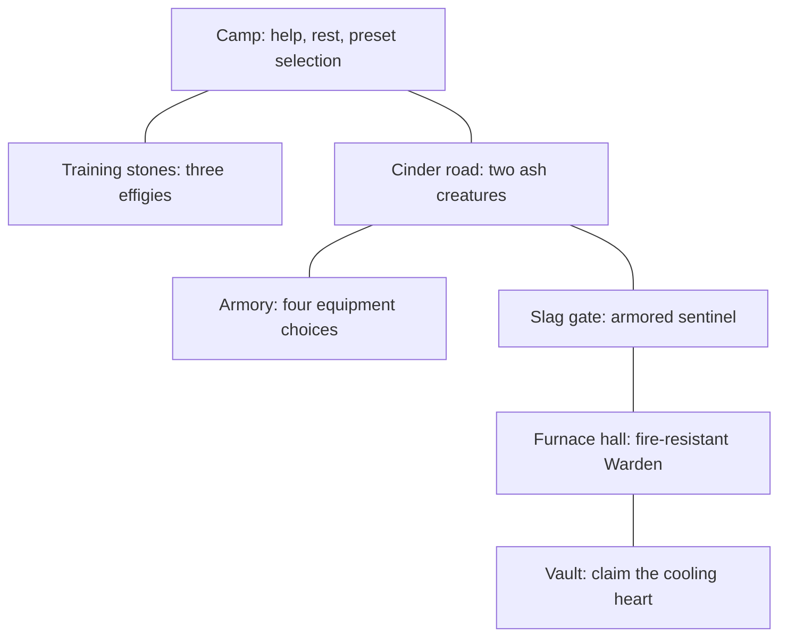

# Playable sample: the Ember Trial

Stage 4 turns the [optional modules](../../14-optional-modules.md),
[composed abilities](../../15-ability-composition.md) and
[combat profiles](../../16-combat-profiles.md) into a small adventure.
Recover a cooling heart from an abandoned furnace, choosing supports and
equipment along the way. It uses current engine APIs and ordinary characters.
No developer permissions, external packages or online services are needed to play.

Everything is installed in a **separate deployment**. The starter world and
other campaigns keep their existing rules. This sample is a teaching adventure,
not an implementation of the remaining ARPG/research proposals.

## Create and play

From the repository root, with Python 3.8+ and a JDK on PATH:

```sh
python3 docs/creator/examples/ember-trial/make_world.py /tmp/sud-ember-trial
python3 docs/creator/examples/ember-trial/play.py /tmp/sud-ember-trial
```

Choose a new destination: the creator refuses to overwrite an existing directory.
The first command copies the content, runs its builder recipe and publishes it.
The second opens the normal game. Make a character; Human/Apprentice works, and
the sample grants its three skills once, regardless of class. It starts you with
140 HP, 180 mana and 300 movement. The builder's profile and saves live separately
under `.build/`; your adventure uses `saves/`.

Use `--restore trial` on `play.py` to restore a named save, or `--new` for a new
campaign. With neither option, the engine offers its usual save selection.
Quote paths containing spaces. The normal launcher accepts the same explicit
WORLDDIR, DBSERVICE and SAVEDIR options if you prefer to launch it yourself.

## Your first expedition

At camp, `TRIAL HELP` lists the adventure commands. `SAY lessons` opens the
keeper's lesson menu. `TRIAL STATUS` is the sample's expedition journal.
It uses typed module state; it is separate from the engine's QUESTS journal.



Begin with the training yard, east of camp:

```text
EAST
COMPOSE LINK embertrial.ember embertrial.burning
COMPOSE SHOW embertrial.ember
COMPOSE CAST embertrial.ember ward effigy
COMBATRESULT
COMBATRESULT 2
```

The unmodified lance deals 24 fire before defenses. The ward effigy has 50%
fire resistance: a successful direct hit removes 12 HP, and its 5-damage burn
removes 3 HP per tick. A result may be a burn tick or a direct hit; indices 1–8
read recent events. Attacks/proficiency and blocks can fail, and explanations
describe what actually happened. `WAIT 2` advances burns and cooldowns.
Long waits stop early when you are attacked; use another WAIT to continue.

The armored effigy has 200 armor. Try `COMPOSE CAST embertrial.blade armored
effigy` to compare physical mitigation. The blocking effigy has spell block
and burning immunity. Training effigies cannot kill you; `TRIAL RESET` restores
them and removes their burns. `TRIAL LEAVE` ends practice combat and returns you
to camp. `TRIAL REST` heals and refills resources there. Neither resets cooldowns.

For the expedition, add two more supports:

```text
TRIAL LEAVE
TRIAL REST
COMPOSE LINK embertrial.ember embertrial.chain
COMPOSE LINK embertrial.ember embertrial.power
COMPOSE SHOW embertrial.ember
NORTH
COMPOSE CAST embertrial.ember Ashling Red
WAIT 2
TRIAL STATUS
```

Chain can reach both ash creatures. Burn snapshots keep damaging them while
you wait. Repeat a cast if it fizzles or a target survives. Native weapon swings
also occur during combat. All encounter creatures are passive until attacked;
you can visit the armory east of the road before fighting if you prefer.

In the armory, use the ordinary item commands:

```text
EAST
GET ember mantle
GET quilted mantle
GET piercing signet
GET critical bracers
WEAR quilted mantle
WEAR piercing signet
COMBATRESULT STATS
```

| Equipment | While worn | Reason to choose it |
| --- | --- | --- |
| Ember mantle | +50 fire resistance | The Warden's composed Cinder spit |
| Quilted mantle | +120 armor | The sentinel's composed Slag hammer |
| Piercing signet | +20 fire penetration | Fire-resistant targets |
| Critical bracers | +25 critical chance; +50 multiplier points | Larger occasional direct hits |

The mantles share one wear slot. `REMOVE quilted mantle` before `WEAR ember
mantle`; stats recalculate immediately. The cloth materials allow an Apprentice
to use them. Profile armor applies to composed physical hits; native weapon
swings retain native combat rules. The enemies demonstrate both, with small
native weapon damage and stronger scripted composed attacks.

Return west to the road, then north to the sentinel. Clear it to enter the
furnace. Switch to the ember mantle for the Warden, whose 60% fire resistance
is reduced to 40% by the worn signet. Defeat it to reach the vault, then:

```text
NORTH
TRIAL CLAIM
TRIAL STATUS
SAVE trial
QUIT
```

The heart is awarded once per character. Restore `trial` in a fresh process:
progress, equipment, loadouts, cooldowns and pending burns remain. Repeating
TRIAL CLAIM grants no second heart. New campaigns start with live encounters,
unclaimed rewards and the default profile.

If an enemy would kill you, the default safety rule returns you alive to camp
with your equipment. Use TRIAL REST and try again. Wounds to surviving enemies
remain; defeated encounters do not respawn. There is no encounter-reset command.

## Compare conversion rules

At camp, outside combat:

```text
TRIAL RULES FINAL
COMPOSE SHOW embertrial.transmute
TRIAL RULES HISTORY
COMPOSE SHOW embertrial.transmute
```

The transmuted shard converts 20 physical to fire with global/typed increases:
the skill sheet shows **44** under final-type scaling and **54** under type-history
scaling, before target defenses. These are the Stage 3 presets, inspired by the
research rather than exact PoE replicas. Choose FINAL again for the walkthrough.
The campaign saves this choice; changing it never rewrites an existing burn.

## Creator controls and recipes

The root manifest selects `embertrial.adventure`, which declares
`combat.profiles`, which declares `abilities.composition`. The assembly tool
copies the published parent manifests and preset files; it does not fork their
hashes. Only this deployment opts into them.

| Edit | File / operation |
| --- | --- |
| Rooms, exits, creature templates, equipment and properties | [Builder recipe](world/resources/creator/build.js) |
| Three player skills, enemy skills and three supports | [Compositions](world/compositions/embertrial.ember.v1.json) and adjacent JSON files |
| Campaign/character state and configurable safety | [Adventure manifest](world/modules/embertrial.adventure.json) |
| Startup grants, progress gates, rescue and rewards | [World hooks](world/js/init.js) |
| NPC skill choice and combat cadence | [Scorch script](world/resources/progs/embertrial-scorch.script), [slam script](world/resources/progs/embertrial-slam.script) |
| In-world build lessons | [Keeper's menu](world/resources/progs/embertrial-guide.script) |
| Fixed-level progression for the short sample | [Progression hook](world/scripts/progression.js) |
| Independent world/database/save assembly | [make_world.py](make_world.py), [play.py](play.py) |

The builder gives creatures saved `Prop_Adjuster` resource bonuses on top of
this world's fixed `FORMULA_NPCHITPOINTS=10`: effigies 1,000 HP; ash creatures 42
each; sentinel 52; Warden 100. Generic MOB imports recalculate base HP; directly
editing `baseState()` alone does not persist those budgets. Saved properties
keep their maximum HP stable across import and restore, while campaign saves
retain current wounds. `onNewGame` initializes NPC loadouts once because
composition choices are campaign-owned state; restore never rebuilds them.

The ordinary `FIGHT_PROG` scripts choose an enemy skill and invoke the existing
COMPOSE adapter, paying its normal resources and honoring its cooldown. This is
an example of authored AI, not a new generic AI support-selection system.

In a builder/DEV session, configure an active campaign with:

```text
WORLD MODULES CONFIGURE embertrial.adventure safe_death false
WORLD MODULES CONFIGURE embertrial.adventure camp_rest false
WORLD MODULES CONFIGURE embertrial.adventure allow_profile_switch false
SAVE challenge
```

These settings respectively restore native player death handling, disable the
free camp refill, and lock the player's convenience preset selector. For future
campaigns, supply the same typed values in `MODULESETTINGS`; follow the
[module guide](../../14-optional-modules.md) for saved settings and migrations.
The adventure command never grants creator permissions.

To change a fresh world yourself, use `make_world.py DEST --prepare-only`, then
launch `CoffeeMud/sud.sh` with `BUILDER=1` and that deployment's paths. Run
`JRUN /resources/creator/build.js` and SAVE. The recipe refuses to rebuild an
existing EmberTrial area. After manual publication, use the engine launcher
with BUILDER omitted, for example:

```sh
CoffeeMud/sud.sh WORLDDIR=/tmp/my-trial/world DBSERVICE=jdbc:fakedb:/tmp/my-trial/db SAVEDIR=/tmp/my-trial/saves RESTORE=NEW
```

The `play.py` wrapper accepts deployments successfully published by the automatic
tool; a partial or failed automatic build is refused. Use the existing `sud.bat`
launcher for manual Windows builder/play sessions.
Subsequent edits use normal editors and SAVE. Published JSON changes need new
versions/pins, explicit reloads and, when applicable, module migrations.

Removing the root from this world's MODULES selection suspends saved adventure
and dependency capsules. Re-enabling it restores saved progress. Its commands,
progress listeners and rescue are guarded by activation; disabling it does not
delete rooms or turn the remaining content into a balanced native-combat game.

## Run the checks

```sh
python3 docs/creator/examples/ember-trial/check.py
# Or through the engine's regular regression harness:
tools/fixes.sh trial
# On a deployment you have already published:
WORLD=/tmp/sud-ember-trial/world python3 tools/playtest.py /tmp/sud-ember-trial/world/tests
```

The main checker creates a disposable deployment, publishes it, plays with no
BUILDER/DEV flags, saves during a burn, completes the encounters with actual
casts, restores the victory, checks the single reward, disables/re-enables the
module and starts a new campaign to test rescue and reset boundaries. It also
verifies that normal play writes neither the published world nor the starter
world. Failed runs keep transcripts; `KEEP=1` keeps successful artifacts too.
The `.play` file supplies a short tutorial replay; `.js` checks structural and
authoring contracts in a separate builder test campaign.
The engine's `.play` runner uses DEV for ASSERT diagnostics; movement gates and
creator-command denial are verified in the main checker's ordinary campaigns.
Headless CHECK=1 reports zero errors; two warnings concern the retained starter
area's disconnected rooms and scaffold text, rather than the adventure.
