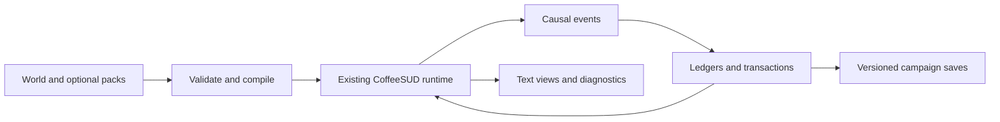

# Proposed architecture, compatibility contracts and delivery order

[Dossier](README.md) · [96 proposals](proposals.md) · [Design cookbook](cookbook.md)

**Everything under proposed contracts and examples below is design work.** No
new parser, module manager, crafting API or combat pipeline was added by this
research task. The goal is a reviewable implementation direction that builds
on the current engine.

## Existing foundation versus new work

The baseline is the [creator handbook](../../creator/README.md),
[feature index](../../creator/feature-index.md) and
[developer-tool audit](../../../audit/developer-tools-audit.md), not historical
unchecked feature plans. The audit records 388 implemented entries, one partial
entry and 20 deliberate deferrals. That inventory does not establish that every
possible combination has been tested.

| Existing capability | Reuse it for | Additional contract proposed here |
| --- | --- | --- |
| Generic classes/races/abilities, costs, masks, hooks and summons | Build definitions and individual powers | A01/A02/A09: typed composition, rule order and inspectable compiled results |
| Trees, prerequisites, ranks, XP and achievements | Discipline progression | P01/P02/A05: general owner-scoped budgets and access evaluation |
| [Affixes](../../../CoffeeMud/com/planet_ink/coffee_mud/core/Affixes.java), loot tables, materials, item sets/growth/attunement | Item generation and improvement | I01–I04: persistent structured modifiers and atomic modification operations |
| Recipes, known recipes, experimentation, stations, salvage, crops | Production and learning | Staged modification, shared input custody and project state |
| Boss phases, telegraphs, waves, scaling, threat and encounter reset | Encounters and tactical bosses | G03: a shared director contract and per-event ownership |
| Travel, journeys, vehicles, instances, generation, seeds and guarantees | Itemized expeditions | G01/G02: entry contracts, route projects and progression outside physical rooms |
| Organizations, factions, merit, dues, diplomacy, shops and banks | Guilds, services and standing | P03/P04/P08: compatibility, source-owned grants and general shared pools |
| Profiles, parties, recruits, followers and summoning | Playable teams and companions | P05/P06: persistent relationships and optional formations |
| Lore, senses, languages, journals, menus, windows and narration | Readable discovery and build tools | A23/Q07: shared knowledge rules and nonmutating presentation |
| MOBPROG saved state, JS JSON stores, event hooks and Java extensions | Prototypes and custom adapters | Q01/Q02: common schemas and explicit limits around dynamic code |

Existing items can have prefix/suffix names, weights, level bounds, power,
curses and effect attachments. That is already useful. It is not the same as
a full PoE-style mutable affix record with independently protected layers,
exclusive groups, value rerolls, provenance and a transaction history. Preserve
old authored files and provide an adapter rather than requiring all worlds to
rewrite their loot.

Several ideas overlap explicit deferrals: generic companions, shared profile
stash, invasions, autonomous warfare, general markets, patron favor/holy-day
integration, exact replay and SIMFIGHT. Reusing an adjacent subsystem must not
be described as having already completed those features. See [LATER.md](../../../LATER.md)
and the handbook's current status notes.

## Optionality is an architectural requirement

1. **Default off:** existing worlds and saves keep their current formulas,
   equipment, actions, death behavior and presentation.
2. **Independent modules:** supports do not require an Atlas; guild research does
   not require random loot; itemized dungeons do not require a real-time combat
   mode; companion bonds do not require an anatomy simulation.
3. **Versioned profiles:** select explicit rule versions. Classic colored linked
   equipment, current permissive socket matching, and skill-local support slots
   are alternative policies, not three automatic layers on one character.
4. **Small presets:** offer a light loot/crafting preset, a tactical-action
   preset, a guild-practice preset and optional activity packs. Avoid one
   “enable every ARPG feature” switch.
5. **Declared composition:** reject incompatible definitions before a game
   starts. Two systems cannot silently own the same action clock or damage stage.
6. **Controlled retirement:** disabling a module in a campaign requires a
   migration, suspension or refusal policy for its existing state. “Off” is not
   permission to delete a player's artifact or strand their party.

A future creator workflow should be: choose a preset or modules, inspect
dependencies/conflicts, configure content and scope, preview, validate, playtest
with ordinary characters, then publish matching assets. New world settings must
be registered in the actual world-setting allowlist and tested for startup,
precedence and reload; inventing an INI key in documentation does not enable it.

### Illustrative manifest, not supported syntax

```yaml
proposal_only: true
id: example.drowned-observatory
schema_version: 1
rules_version: 1
requires:
  example.support-composition: 1
  example.expedition-contracts: 1
conflicts: [example.classic-colour-restrictions]
clock_modes: [turns, game_ticks]
state_sections: [expeditions, crafting_receipts, artifact_mastery]
definitions:
  - abilities/echo-spear
  - expeditions/drowned-observatory
removal_policy: refuse_while_expedition_active
```

This illustrates the information a manifest needs. File format, parser,
commands and Java interfaces should be finalized during Q01/Q02. Definitions
must use stable namespaces and report collisions; the manifest must not turn
arbitrary scripts into safe, pure or budgeted code by assertion.

## A small set of durable concepts

| Concept | Owns | Example |
| --- | --- | --- |
| Definition | Authored rules and stable source identity | A support, a recipe, a bond type, a dungeon template |
| Rules context | Enabled modules, versions, clock and scope | A tactical campaign in a particular season |
| Grant source | The reason a capability is active | Item socket, affiliation, tree node, body module, temporary boon |
| Ledger | Progress and balances belonging to a declared owner | Guild research, artifact mastery, a companion relationship |
| Activity instance | Participants and state of a run/project | A heist, temple project, trial or shipment |
| Causal event | A stable cause and already-processed consumers | A kill, capture, craft completion or discovery |
| Transaction receipt | Committed costs, outputs and reward state | A chosen craft outcome or banked trial reward |

Do not require a distinct Java manager for every historical league. New content
should usually supply definitions to these shared contracts. New primitives are
justified where a genuinely different state model is needed: anatomy, graph
patches, cross-item transactions or reciprocal bonds.

The proposed integration keeps the native runtime in the center:



### Identity and scope

An authored source ID, physical object ID, character/profile ID, relationship
ID and activity instance ID do different jobs. A copied sword gets a new
physical identity, but it can share an artifact-family mastery ID. A regenerated
dungeon can retain the same source definition while representing a different
run. A key can be restricted to one run even if its visible name is unchanged.

Each ledger declares one owner scope: character, profile **within a world/rules
scope**, organization, relationship, physical item, artifact family, expedition
or campaign. Cross-scope rewards require an explicit transfer operation. This
prevents a temporary league's research from becoming unintended permanent power
in every world using the same local profile.

Store JSON-compatible values and stable IDs; resolve live objects when acting.
Define what happens when resolution fails: suspend, cancel with compensation,
bind to an approved replacement, or refuse migration. Never pick an arbitrary
same-named mob. Display names must remain free to change.

## Composition and rule execution

### Ability compilation

A composed ability should have a base definition, eligible support slots,
source-owned transformations, final tags, costs, reservations, targeting,
delivery, timing, scaling and a readable explanation. Compilation checks
compatibility and cycles without consuming resources or random numbers.

Prefer a finite set of supported transformations: add a projectile, change a
delivery method, multiply cost, attach a condition, replace a scaling stat or
alter a cooldown. A dynamic script adapter is an escape hatch. Its results are
not statically provable, and previews should say so rather than invent an exact
damage number.

### Proposed hit pipeline

```text
source/ownership -> base and added values -> conversion/gain policy
 -> applicable scaling -> hit/critical decision -> target mitigation
 -> damage application -> independently calculated ailments/recovery
 -> committed outcome -> bounded causal reactions and messages
```

The chosen rules profile defines exact ordering, units, caps, snapshots and
rounding. Some profiles will place a particular stage differently. Intercept
the native combat/message pipeline at controlled points so ordinary armor,
immunity, legality, defeat and death handling still run. Do not create a parallel
script-only damage path that bypasses those systems.

An original arithmetic check: base damage 100 with +20% and +30% in one additive
group, then 10% more, yields 165 before defenses. The explanation should name
each source. Removing the +20% item should recompute 143, not subtract a guessed
amount from a cached total. Conversion-specific examples need their own preset
fixtures; PoE1-like and PoE2-like scaling must deliberately differ where intended.

### Events, proxies and control

Every triggered action carries a causal root, source instance, owner,
controller, originating skill and processed-consumer record. Specify separate
credit policies for damage, threat, experience, loot and legal consequences.
Bound trigger depth, work per tick and active proxy count. A proc creating a
proc cannot silently escape the originating action budget.

Existing player, NPC AI, party orders, dialogue input and scripted actions need
one authority rule. A single actor cannot simultaneously follow two exclusive
movement controllers. Formation/reaction policies must still obey party limits,
stuns, downed states, travel restrictions and the existing switching behavior.
Include feigned death in switching integration checks.

The user's proposed execution/choreography runner remains a **draft**, separate
from existing ambient `Scene` behavior. Future tactical events could trigger it,
but it should not be a prerequisite for the ARPG foundation. Its control policy
can be a per-role mask: victim only, initiator only, both or neither. The agreed
default is both participants controlled while the world continues; a free
initiator remains a valid override. An execution outcome must re-enter normal
damage, defeat, displacement and world-mutation rules.

## Item operations and rewards must settle together

I03 is a foundation, not a convenience wrapper around several arbitrary commands.
A proposed local transaction has these stages:

1. Resolve owner, source objects, currencies and rules version.
2. Validate costs, custody, modifier compatibility, capacity and outstanding
   claims. Produce a pure preview or a stable choice set.
3. Stage the result and record the intended random stream/outcome. Opening or
   redrawing a choice does not reroll it.
4. Commit consumption, item mutation/output creation, balance changes and a
   receipt as one game-thread state transition.
5. Publish bounded post-commit events through an idempotent event/outbox policy.
   An observer failure reports an error; it does not rerun the craft.

Save snapshots must occur at consistent transaction boundaries. On restore,
inputs, outputs and receipts must come from the **same committed snapshot**.
This provides once-only behavior relative to saved campaign state. It is not
a claim of durable settlement with an external market or service across a
machine crash. A remote economy would need its own authoritative transaction
and reconciliation design.

Arbitrary Java/JS callbacks cannot be rolled back reliably after they mutate
unrelated objects or external systems. Keep the commit portion in controlled
engine operations, make preparation pure where possible, and separate advisory
scripts from authority. Do not promise a general ACID transaction for arbitrary
creator code.

Reward state should distinguish provisional, banked, forfeited, available and
claimed. Bind rights to a declared owner. A party can share encounter completion
while each eligible character has a separate reward claim; two characters on
one profile should share only when the content explicitly chooses that scope.

## Clocks, pausing and stopping a session

Choose a clock for every deadline: action steps, game ticks, game calendar or
real time. Document whether a controlled actor waiting counts as an action,
whether the rest of the world continues, and whether an unattended off-screen
activity catches up. Reading a paused menu is not a failed dodge.

Save a state machine's stage, participants, chosen options, remaining time,
pending outcomes and cleanup policy. Do not save an arbitrary interpreter stack
or closure. On restore, register code idempotently and resume from the durable
stage. The current [state/persistence matrix](../../creator/state-and-persistence.md)
already establishes these boundaries.

G20/P07 need bounded catch-up. Compute summarized production through a declared
interval with capacity/input checks, rather than replaying every missed combat
tick. A background job may calculate a JSON plan; only the game-thread callback
can validate and apply it. Current background jobs are not saved. A mission's
authoritative progress must not live only in a worker promise.

## Player and creator presentation

Every advanced system needs an inspectable text view: legal supports and why,
tree neighborhoods and refunds, item modifier layers, crafting costs/stakes,
active defenses, minion ownership, formation roles, bond benefits and expedition
state. A pretty optional client cannot be the only usable interface.

Use the existing help, menus, narration and windows. Add semantic messages and
stable option IDs; color is supplemental. Group repeated proxy attacks and loot
by policy. Make important telegraphs concise and repeatable through inspection.
Creators can inspect hidden mechanics; ordinary players receive the knowledge
view chosen by the world. Both views should draw from the same rule evaluation.

## Known baseline limits to address before relying on them

The current audit reports a cached-catalog uniqueness/cap smoke failure whose
cache-creation cause remains unresolved. Before building an economy that relies
on unique drops or capped generated items, reproduce and fix or explicitly
isolate that path. Do not present the aggregate smoke suite as passing.

It also identifies world-setting allowlist omissions for seven presentation
settings, a `world:` script-lint resolver gap, and false unknown-key warnings for
dynamic property keys. These are concrete authoring-tool issues to account for
when designing Q01/Q02. The appropriate baseline repair is shared schemas and
resolvers, not documenting a new set of silently ignored settings.

Interpreted JS has instruction budgeting, but arbitrary synchronous compiled
Java/native calls cannot safely be force-preempted. Saved dice and generated
seeds are useful, but arbitrary I/O, native timing and code changes prevent a
general exact-replay promise. Q04/Q09 must report those limits honestly.

Run headless simulations that include arbitrary creator code in disposable
child processes. A supervisor can stop a stalled process without attempting
unsafe forced interruption of native code inside the live campaign. Report
such a timeout as an incomplete simulation, never a proven combat outcome.

## Delivery sequence

### Phase 0: prove the contracts and repair blockers

Inventory the existing schemas and ownership rules; introduce Q01/Q02; settle
the catalog-cache issue before relying on item uniqueness; publish the new
definition compatibility/version policy. Choose one default-off world pack for
experiments. Confirm an ordinary existing world runs unchanged.

### Phase 1: small shared foundations

Implement the minimum A01/A02/A03/A09, I01/I03/I04/I18, G01/G03 and P01 contracts
needed for one vertical slice. Extend Q03/Q05/Q06/Q07/Q08/Q12 alongside them.
Do not attempt every delivery method, defense or crafting currency first.

### Phase 2: a playable original pack

Build the Drowned Observatory from the cookbook: a small support build, limited
crafting, a charted expedition, a two-phase boss and one companion relationship.
Add only the required loadout, status, formation and progression features.
Creators must be able to build, inspect, play, stop, restore and revise it.

### Phase 3: select activities and social depth

Choose a few of Delve-like exploration, Heist-like preparation, temple topology,
faction operations, guild research, settlements or constraint-authored challenges.
Use the same state/reward contracts. The selection should follow the user's
interest and playtesting, not the chronological order of PoE leagues.

### Phase 4: evaluate the largest independent projects

Consider arbitrary graph-changing jewels, full anatomy, general spatial
crafting, tower defense, procedural challenge proofs, rebirth and asynchronous
markets independently. Each should have its own reviewable design and prototype.
A network marketplace is not a prerequisite for any earlier phase.

## Common acceptance gates for implementation

* **Compatibility:** a pre-feature world/save has the same observable baseline
  behavior with modules disabled. No default balance, party-cap or death change.
* **Actual persistence:** start, reach an intermediate state, save, exit the
  process, restore, finish/cancel, save again; also test a pre-change save after
  a compatible definition migration.
* **Ownership:** two characters, two item copies and two expedition instances
  do not share state accidentally. Test source removal and duplicate events.
* **Time/control:** turns, ticks, manual pause, menus, switching, downed/feigned
  death and off-screen catch-up obey the declared policy.
* **Composition:** validate incompatible supports, empty craft pools, unreachable
  layouts, missing actors, excessive triggers and competing controllers.
* **Reward integrity:** cancel, retreat, die, reload and repeat near a reward
  boundary without duplicating claims, equipment or costs.
* **Readability:** complete the pack without color, graphical positioning or
  external build tools; inspection explains a refused action without mutation.
* **Bounded work:** enforce actor, event, queue and catch-up limits. Simulations
  stop on a stall and distinguish sampled results from guarantees.

These are proposed feature acceptance requirements. This research pass performs
document/catalog checks; it does not claim these runtime scenarios have passed
for systems that have not been implemented.
